# 4-bit CMOS Binary Counter with Parallel Carry

Course project "Design of Microelectronic IP Blocks" (SPbPU, 2025). A synchronous binary up counter was synthesized from MOSFETs, simulated at schematic level, laid out in Cadence Virtuoso, extracted, and re-simulated with parasitics.

**Tools:** Cadence Virtuoso (schematic, layout, ADE), QRC (extraction), Spectre. **Technology:** 0.18 um CMOS, 1.8 V supply.

## Results

| Stage | Result |
|-------|--------|
| Function check | Correct count sequence at 1 MHz (schematic and extracted layout) |
| Schematic-level speed limit | 1.35 GHz clock, correct counting and signal levels |
| Layout area | about 1200 um2 |
| Post-layout speed limit | 900 MHz empirical limit; reliable operation shown at 850 MHz |

Parasitics reduced the maximum clock frequency from 1.35 GHz to about 0.9 GHz (roughly one third lower).

## Design flow

1. **Specification.** The counter skips the states 0001 and 1000, so the truth table has 14 valid states. Parallel carry computes the next state of all bits at once, which avoids ripple-carry delay.
2. **Logic synthesis.** Karnaugh maps for the D inputs D1-D4, with the expressions reduced to NAND/NOR-style forms. For D3 the pull-up and pull-down contours do not overlap, so the two transistor networks were merged and the part with the most transistors at one node was shared.
3. **Schematic.** The combinational blocks D1-D4 and a pass-transistor D flip-flop were built in Virtuoso. Each combinational block drives a flip-flop that provides Q and nQ.
4. **Schematic simulation.** Test bench with a clock source; function check at 1 MHz, then the clock was raised until counting failed (1.35 GHz).
5. **Layout.** Separate layouts for the D flip-flop and for D1-D4, then the counter cell.
6. **Extraction and post-layout simulation.** The extracted view was simulated with the same test bench.

## Schematic

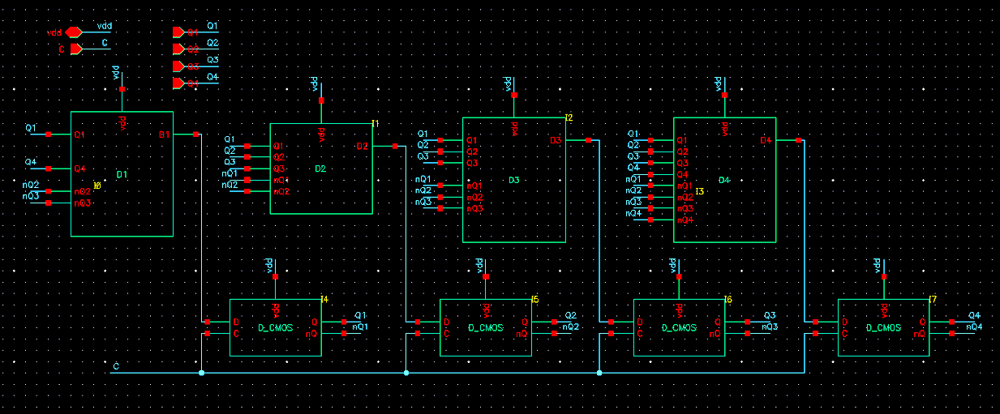

D flip-flop on pass transistors, schematic and simulation:

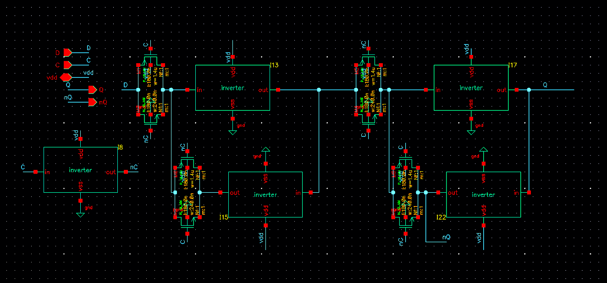
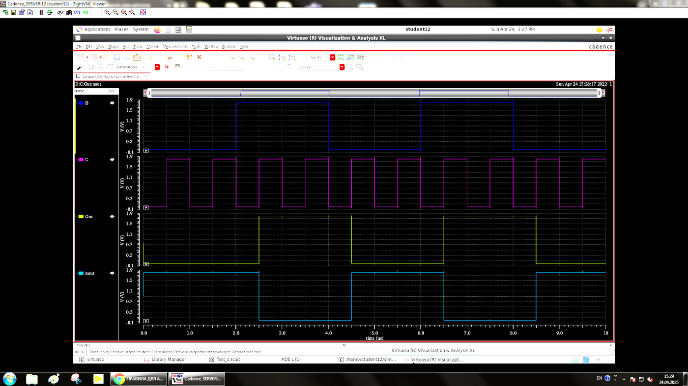

## Schematic-level simulation

1 MHz, all four outputs follow the count sequence:

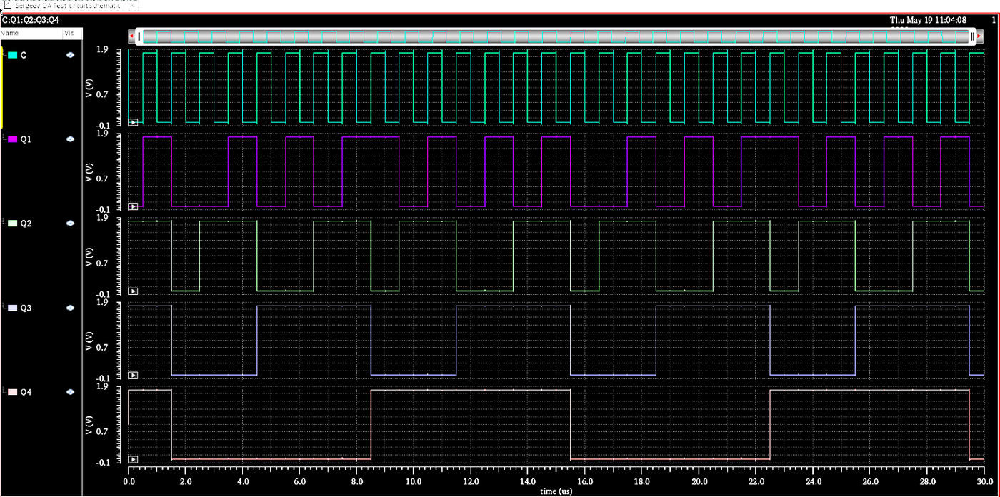

1.35 GHz, the highest clock frequency with correct counting at schematic level:

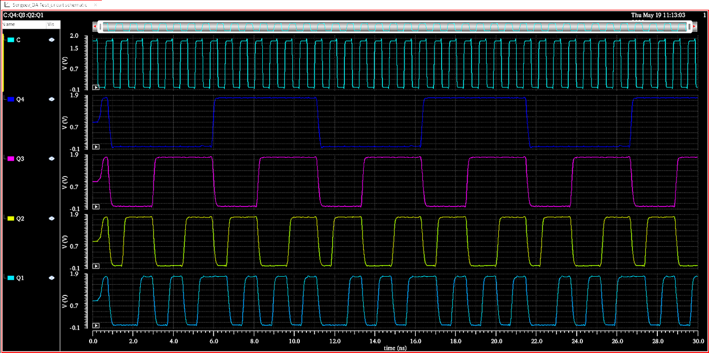

## Layout

D flip-flop and combinational blocks D1-D4:

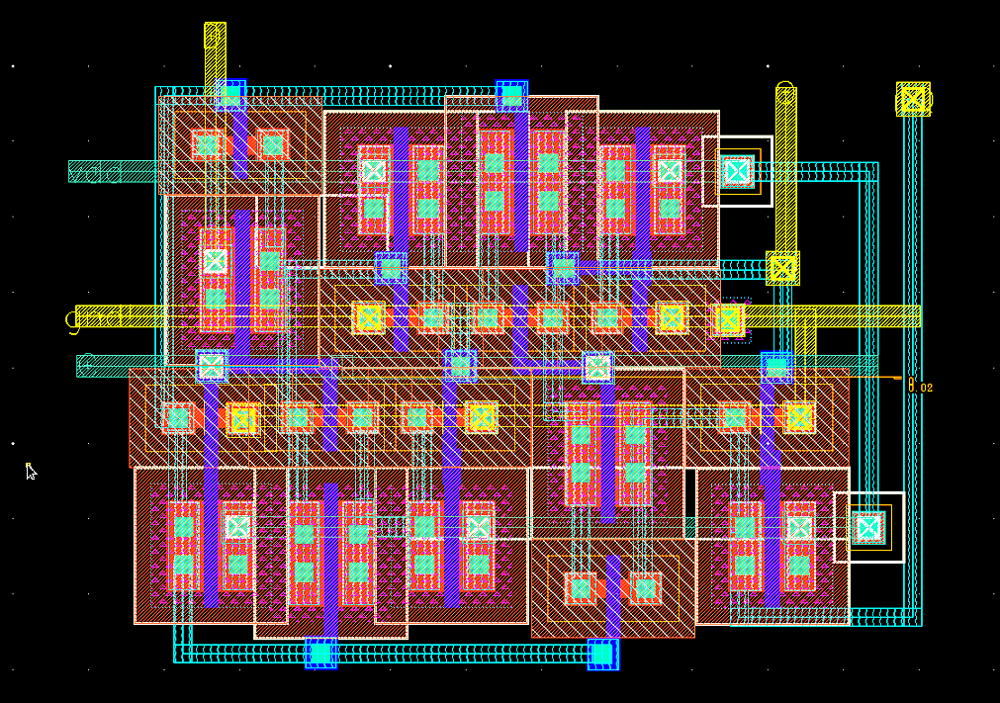

| D1 | D2 | D3 | D4 |
|----|----|----|----|
| 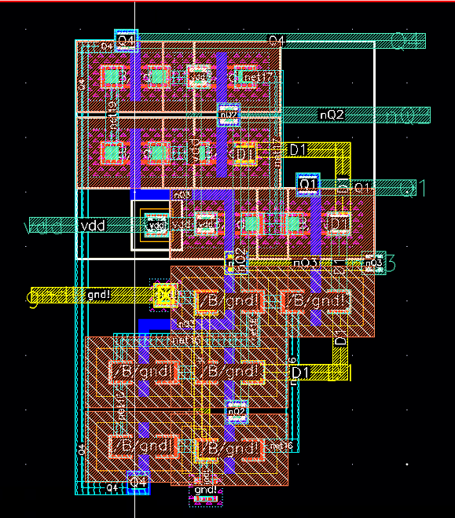 | 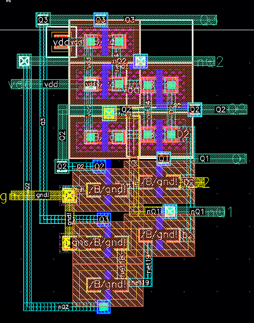 | 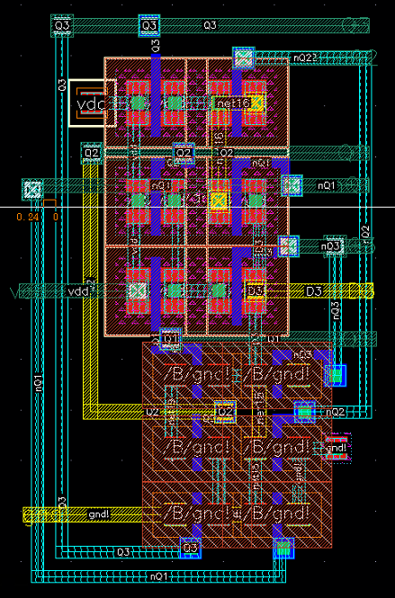 | 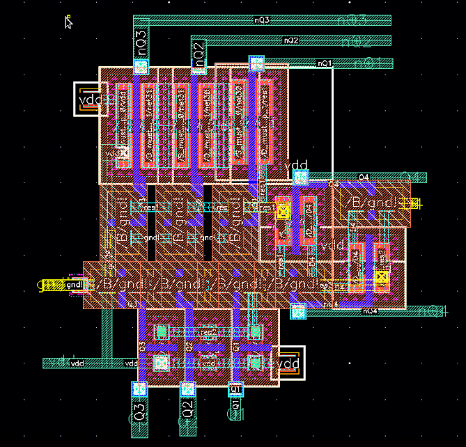 |

Counter layout (about 1200 um2):

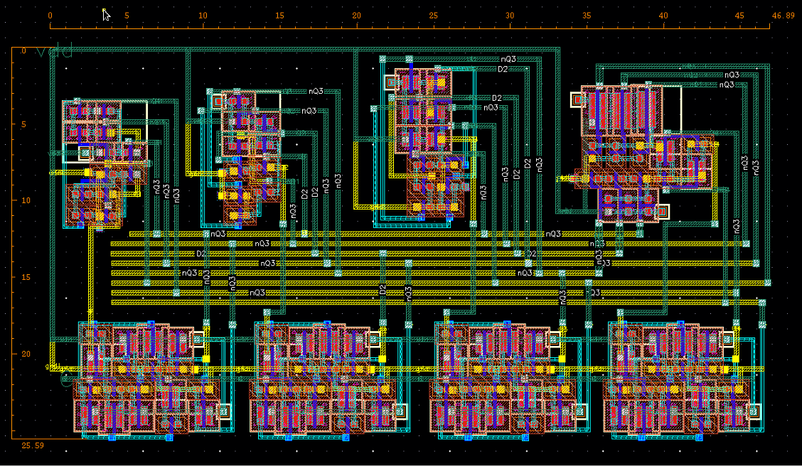

Extracted view with parasitic elements:

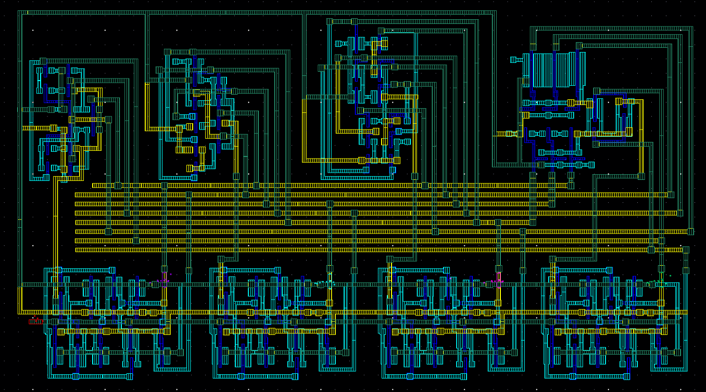

## Post-layout simulation

1 MHz:

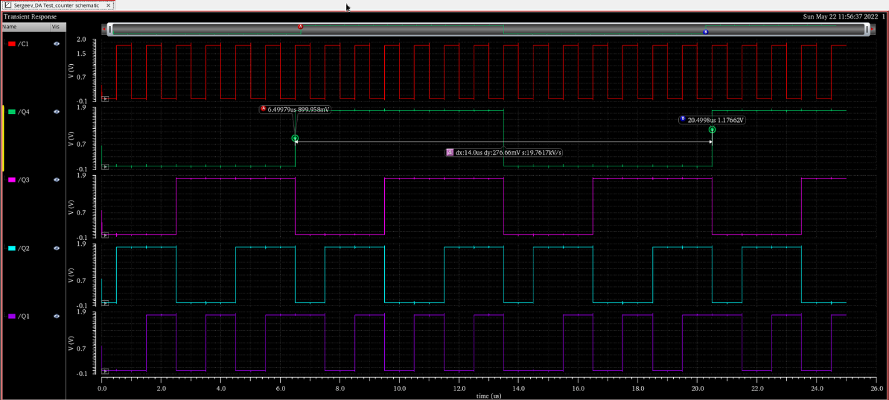

900 MHz (limit found empirically) and 850 MHz (reliable operation):

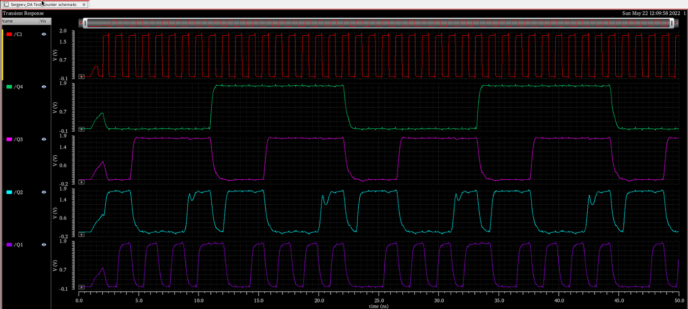
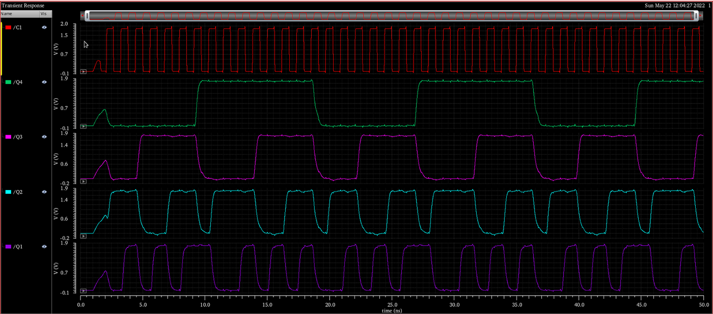
