# CMOS Digital Cell Library at Transistor Level

Practical works for the course "Design of Microelectronic IP Blocks" (SPbPU, 2025). Logic gates, multiplexers, latches and flip-flops were built at transistor level in Cadence Virtuoso and characterized in Spectre. The p-transistor width of every cell was tuned so that rising and falling delays match.

**Tools:** Cadence Virtuoso (schematic, ADE), Spectre. **Technology:** 0.18 um CMOS, 1.8 V supply.

## Cells

- NAND with 2-5 inputs, NOR with 2-5 inputs
- XOR and XNOR
- Multiplexers with 1-3 address inputs
- RS latch and clocked RS flip-flop
- D flip-flops on pass transistors (CMOS and n-MOS versions), D flip-flop with dynamic control, T and JK flip-flops

## Method

- **Test setup.** The input signal passes through a chain of 7 inverters and a VCVS buffer; the load is 1 inverter (x1) or 10 inverters (x10).
- **Delay balancing.** The p-transistor width was swept until the 0-1 and 1-0 switching delays were equal (symmetric cell).
- **Characterization.** Delays and rise/fall times were measured for both loads at the balanced width.
- **Reuse.** Balanced gates and the 2-input multiplexer were reused to build the larger cells (RS, D flip-flops).

## Balanced widths and delays (x10 load)

| Cell | Balanced p-width | Delay 0-1 / 1-0, ps |
|------|------------------|---------------------|
| 2-NAND | 550 nm | 231.8 / 230 |
| 3-NAND | 400 nm | 329 / 325 |
| 4-NAND | 330 nm | 465 / 460 |
| 5-NAND | 270 nm | 583 / 590 |
| 2-NOR | 1590 nm | 187.2 / 187.9 |
| 3-NOR | 2360 nm | 184.1 / 183.5 |
| XOR | 1730 nm | 226 / 226 |
| XNOR | 1580 nm | 201 / 200 |
| 1-address MUX | 1400 nm | 191 / 191 |

Example of the sweep for the 2-NAND (p-width vs delay, x10 load):

| p-width, nm | 0-1, ps | 1-0, ps |
|-------------|---------|---------|
| 400 | 252.7 | 228 |
| 500 | 237.1 | 229 |
| 600 | 229.8 | 232 |
| **550** | **231.8** | **230** |

## Flip-flops (x10 load)

| Cell | Rise delay, ps | Fall delay, ps |
|------|----------------|----------------|
| Asynchronous D | 315 | 589 |
| Dynamic D | 301 | 582 |
| T | 310 | 602 |
| JK | 309 | 601 |

CMOS vs n-MOS pass-transistor D flip-flop (Out / nOut, 0-1 and 1-0 transitions, x10 load):

| Version | Out 0-1, ps | Out 1-0, ps | nOut 0-1, ps | nOut 1-0, ps |
|---------|-------------|-------------|--------------|--------------|
| CMOS | 234 | 272 | 508 | 310 |
| n-MOS | 172 | 379 | 671 | 243 |

## XOR implementation comparison (individual task, variant 12)

Two XOR circuits were compared with n-MOS width 460 nm.

| Circuit | Transistors | p-width | Delay | Average current |
|---------|-------------|---------|-------|-----------------|
| T.1 | 12 | 1370 nm | 180 ps | 28.12 uA |
| T.4 | 14 | 705 nm | 150 ps | 18.85 uA |

T.4 is about 17% faster and draws about 33% less average current than T.1.

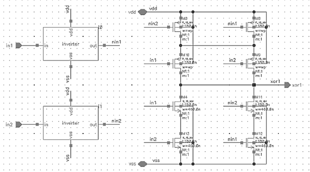
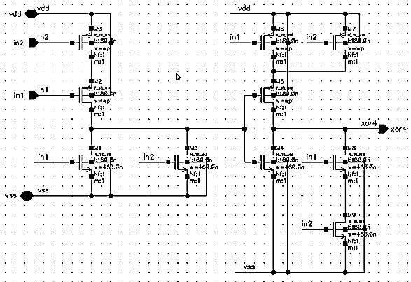
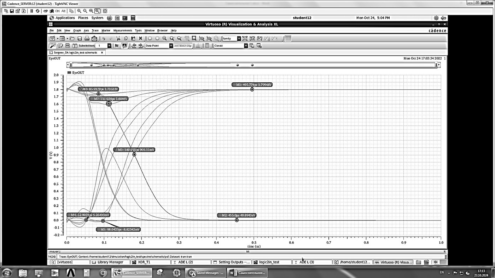

## Schematics

| Cell | Schematic |
|------|-----------|
| 2-NAND | 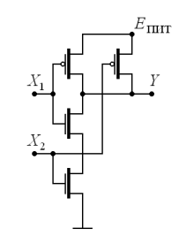 |
| XOR | 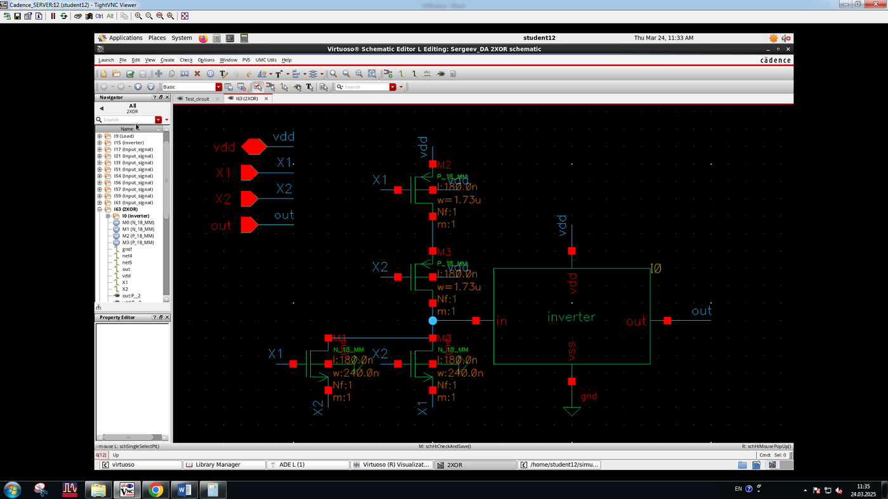 |
| XNOR | 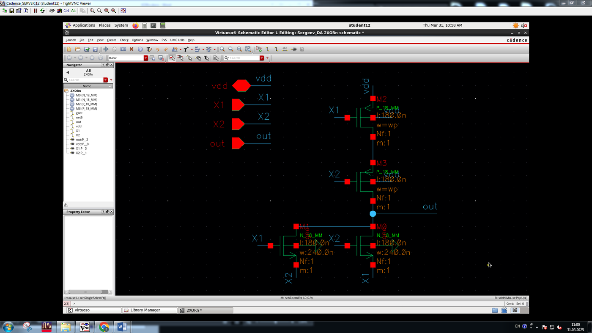 |
| 1-address MUX | 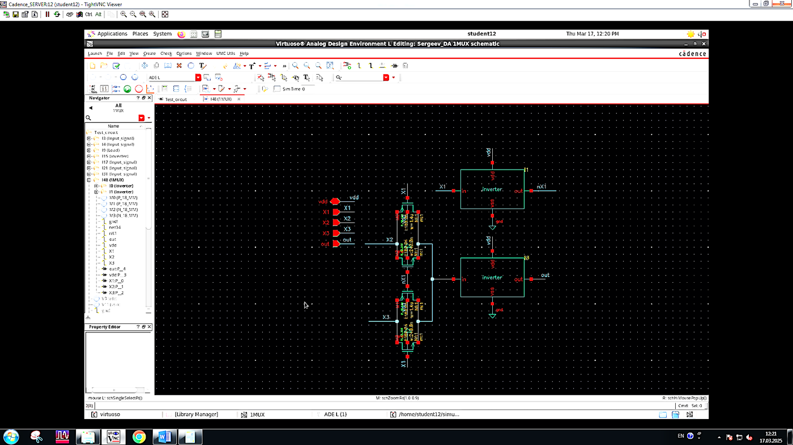 |
| RS latch | 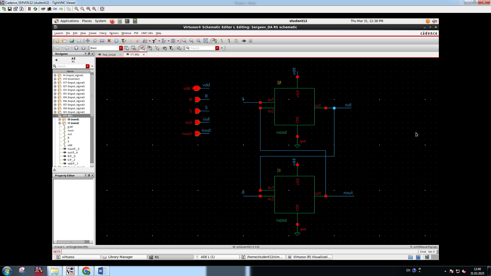 |
| Clocked RS | 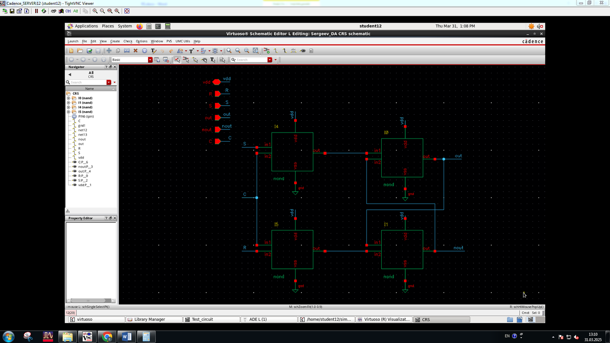 |
| D flip-flop (CMOS) | 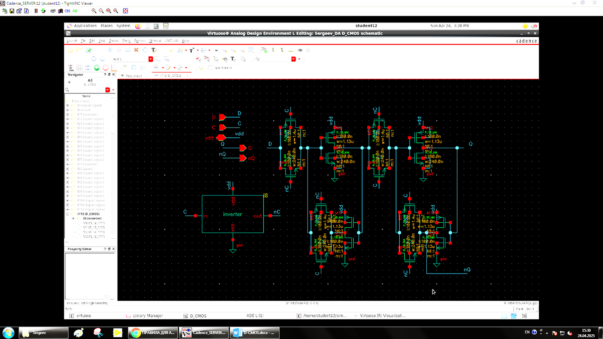 |
| D flip-flop (n-MOS) | 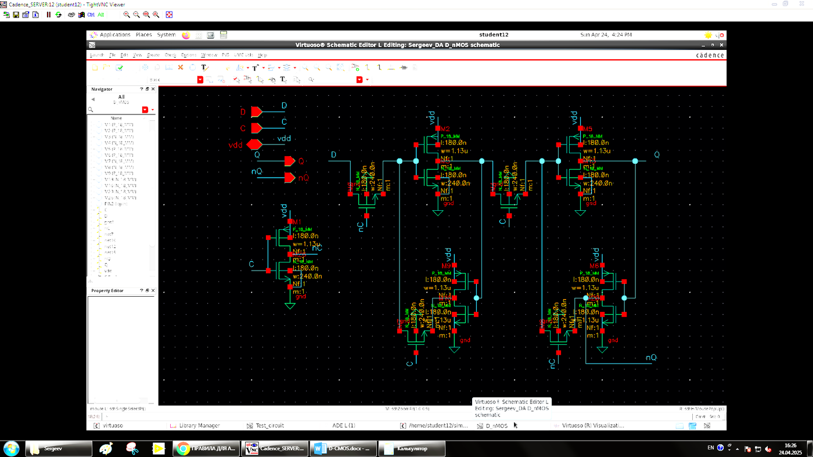 |

n-MOS D flip-flop, time-domain behavior:

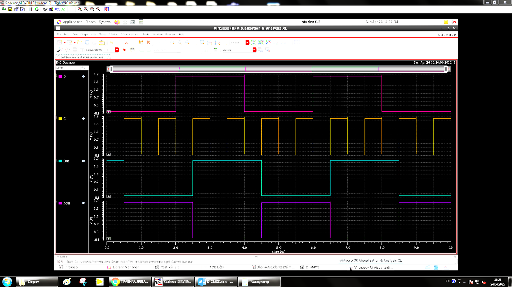
