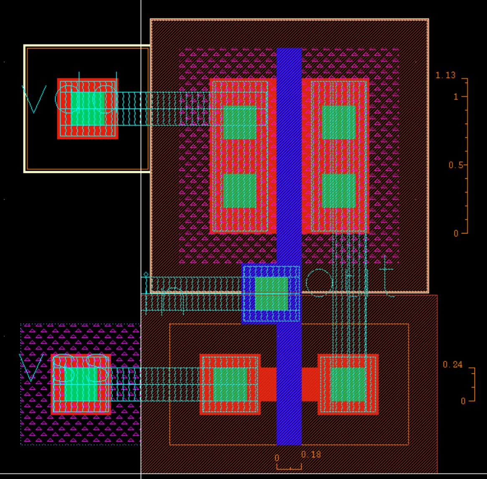
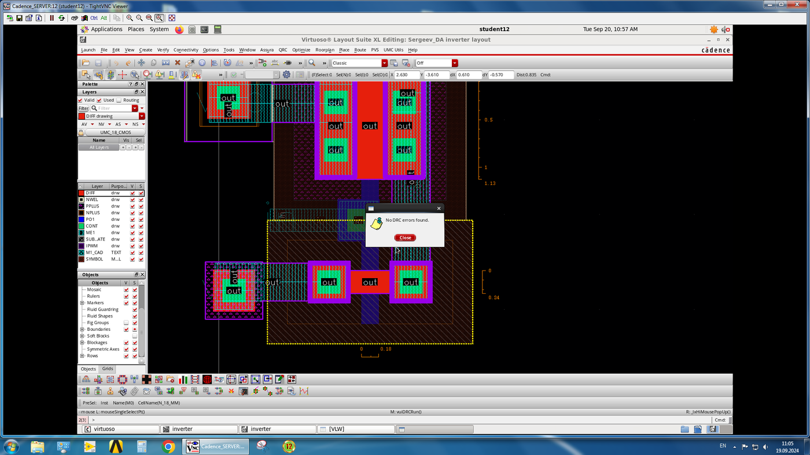
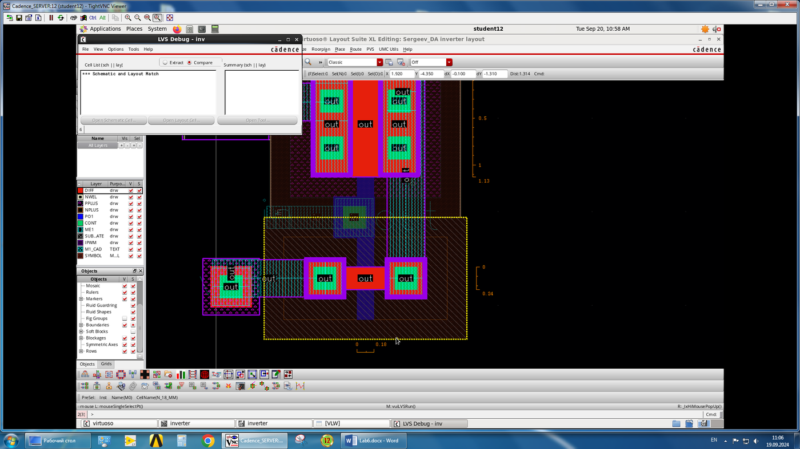
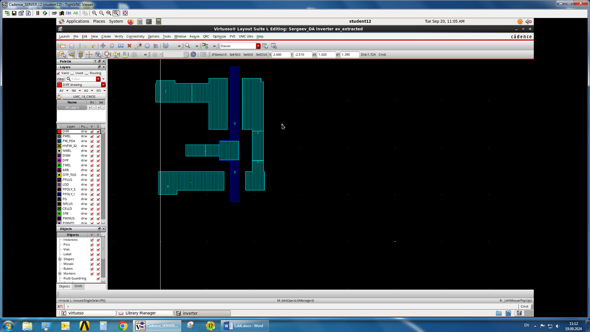
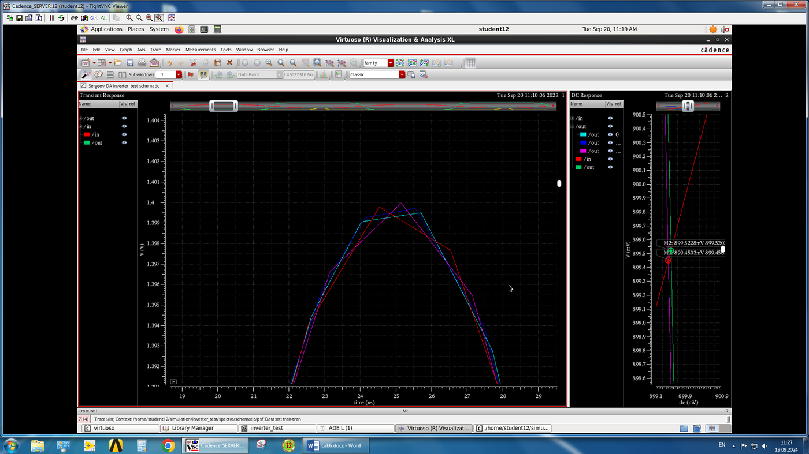
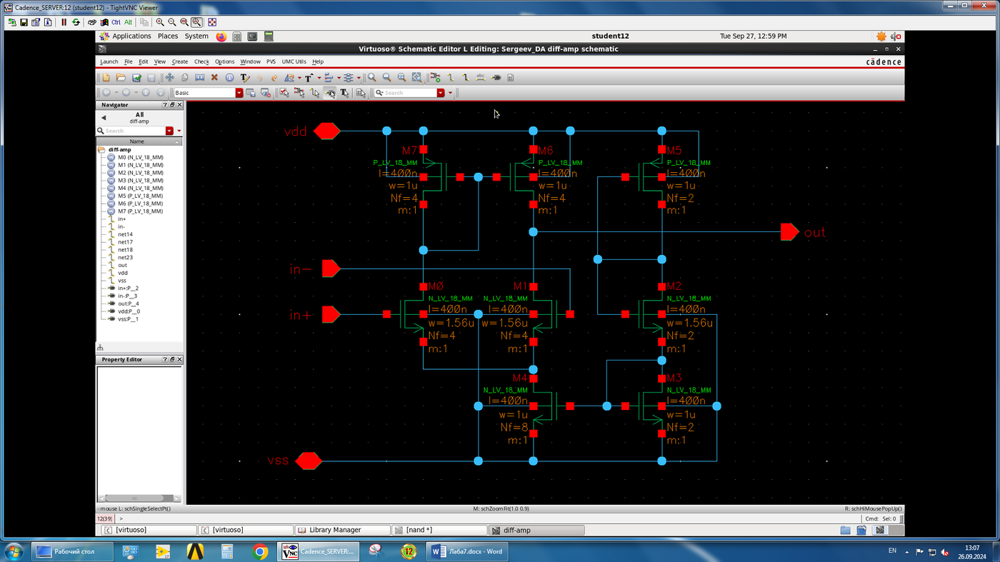
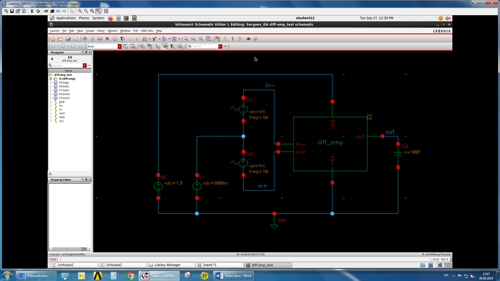
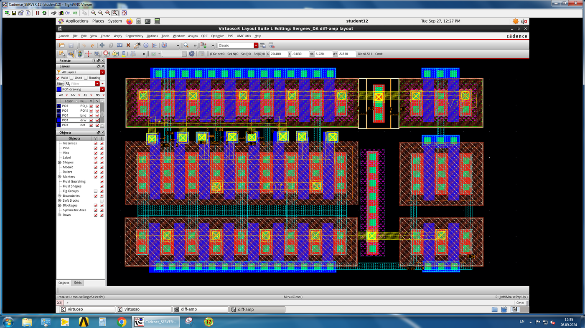
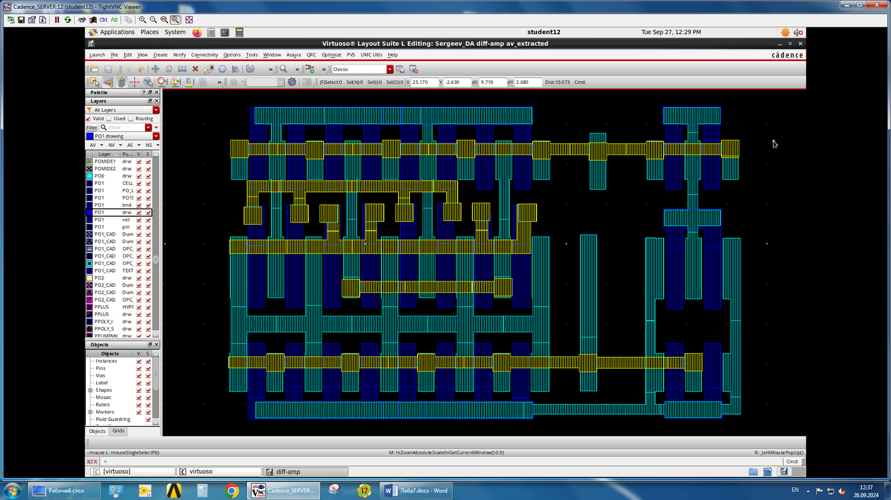
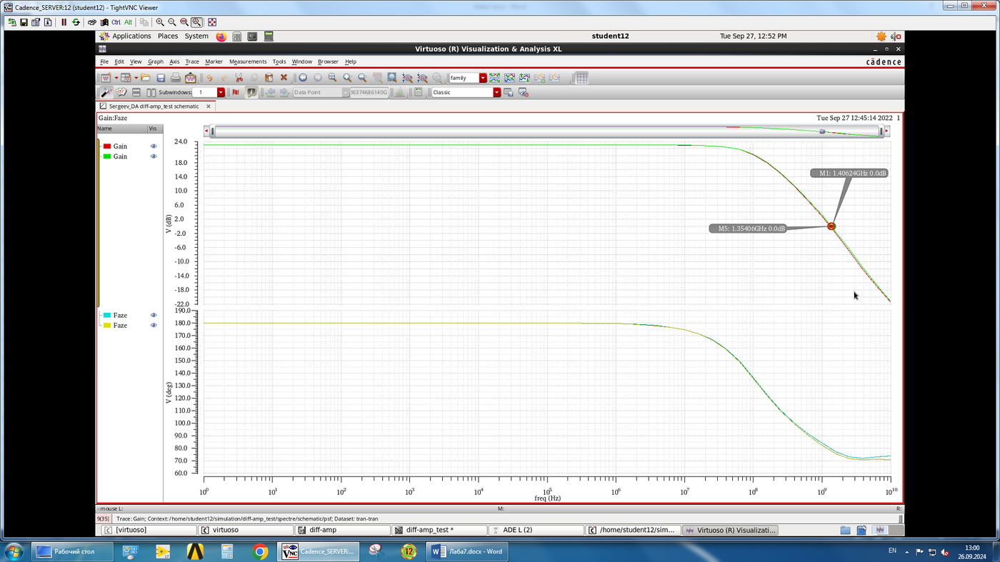

# CMOS Inverter and Differential Amplifier: Layout, Verification, Extraction

Laboratory works "Introduction to Integrated Circuit Modeling" (SPbPU, 2024). A CMOS inverter and a CMOS differential amplifier were drawn in Cadence Virtuoso Layout XL, checked with DRC and LVS, extracted, and the extracted views were simulated and compared with the schematics.

**Tools:** Cadence Virtuoso (Layout XL, ADE), Assura (DRC, LVS), QRC (extraction), Spectre. **Technology:** 0.18 um CMOS, 1.8 V supply.

## Results

| Block | Verification | Post-layout vs schematic |
|-------|--------------|--------------------------|
| Inverter | DRC: no errors; LVS: schematic and layout match | DC output differs by about 0.5 mV; small shift also visible in the transient response |
| Differential amplifier | Layout with matched devices in the differential pair and the current mirror | Unity-gain frequency changes from about 1.41 GHz (schematic) to about 1.35 GHz (extracted) |

Schematic-level amplifier gain at low frequency is about 23 dB (see project 5).

## Inverter

Layout:

DRC result ("No DRC errors found") and LVS result ("Schematic and Layout Match"):

Extracted view, and simulation overlay of the schematic and extracted netlists:

## Differential amplifier

Schematic and test bench:

The layout uses multi-finger transistors, with the differential pair and the current mirror devices made equal for matching.

AC response, schematic vs extracted (markers at 0 dB gain: 1.406 GHz and 1.354 GHz):

