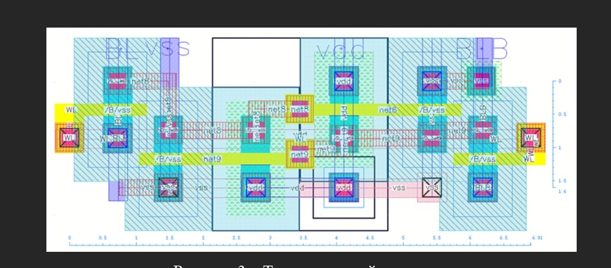

# SRAM Cell Layout and 4x4 Array

Individual task, variant 12 (SPbPU, 2024): create a compact layout of a static RAM cell, pass the verification checks, build a 4x4 array, and estimate the effective cell area.

**Tools:** Cadence Virtuoso (Schematic, Layout XL). **Technology:** 0.18 um CMOS.

## Task parameters

| Parameter | Value |
|-----------|-------|
| Cell type | 5 |
| Transistor width | 430 nm |
| Array | 4x4 cells with shared BL, BLB and WL buses |

## Approach

- Transistors and vias were placed as compactly as the layer spacing rules allow, to minimize the effective area.
- The cell is not symmetric, so in the array every even row and column is mirrored horizontally and vertically.
- The 4x4 array schematic has 4 lines each of BL, BLB and WL.

## Result

- Cell layout size: about 6.9 x 1.6 um (from the layout ruler).
- Effective area of the 4x4 array: about 248 um2, within the allowed 150% of the reference area (10.5 um2 per cell).

## Cell layout

Bit lines BL and BLB, word line WL, and the vdd and vss rails are labeled in the layout.

