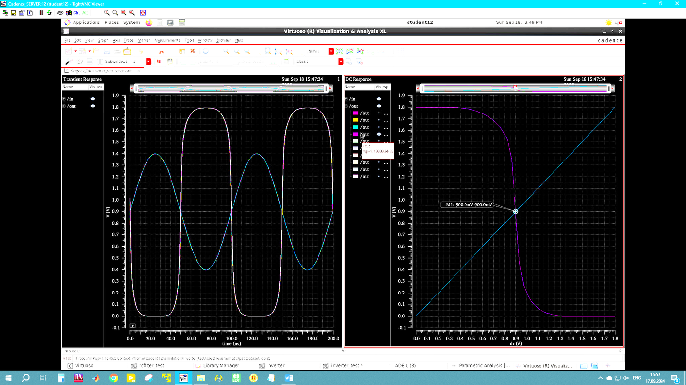
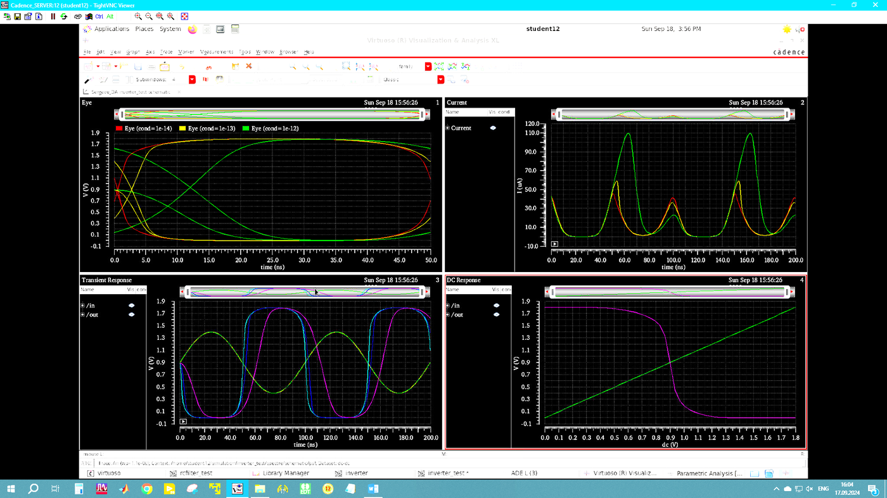
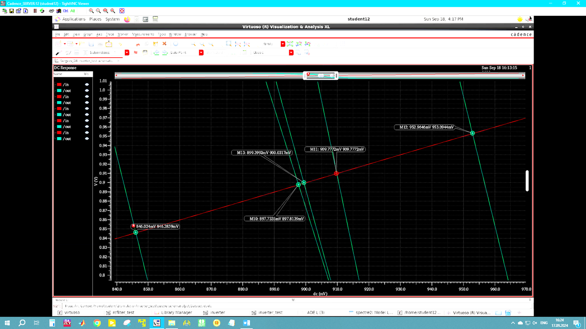
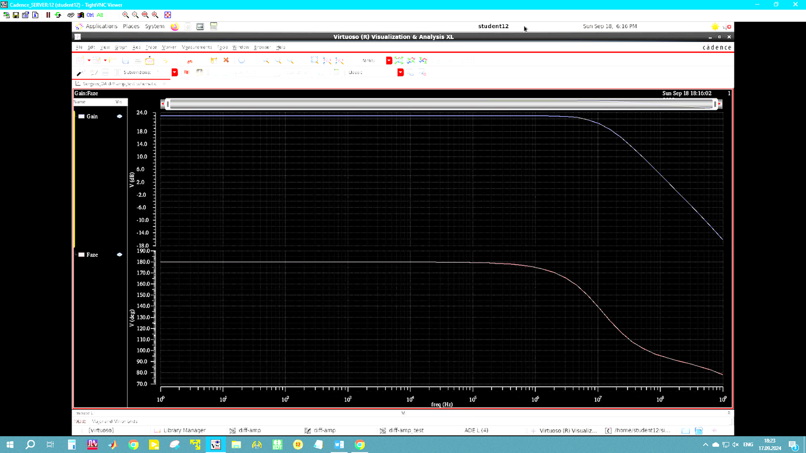
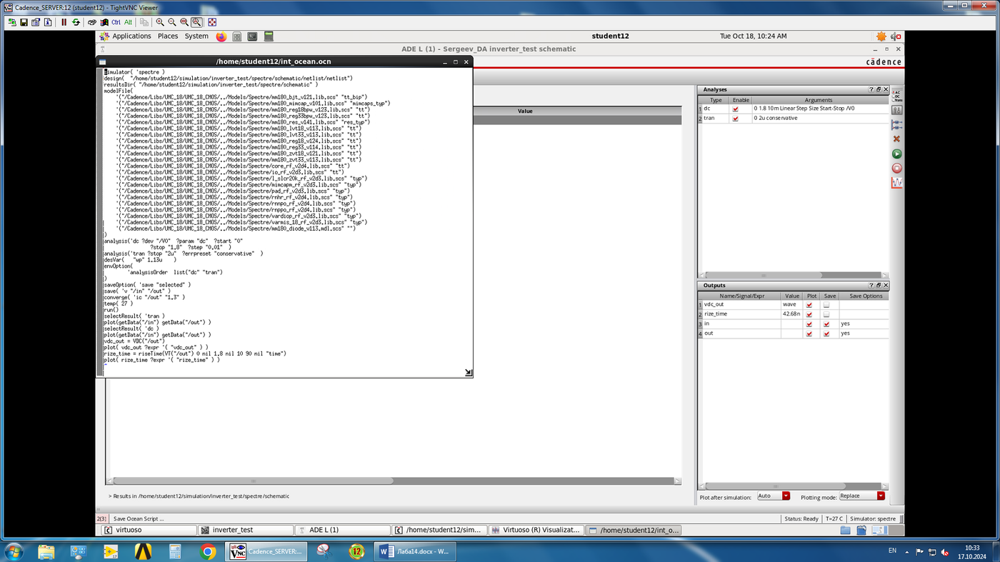
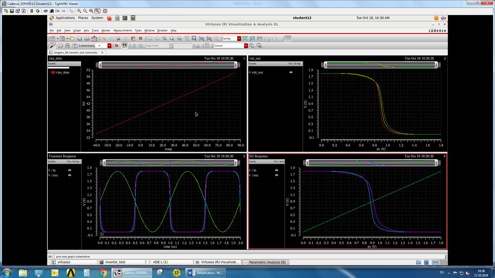
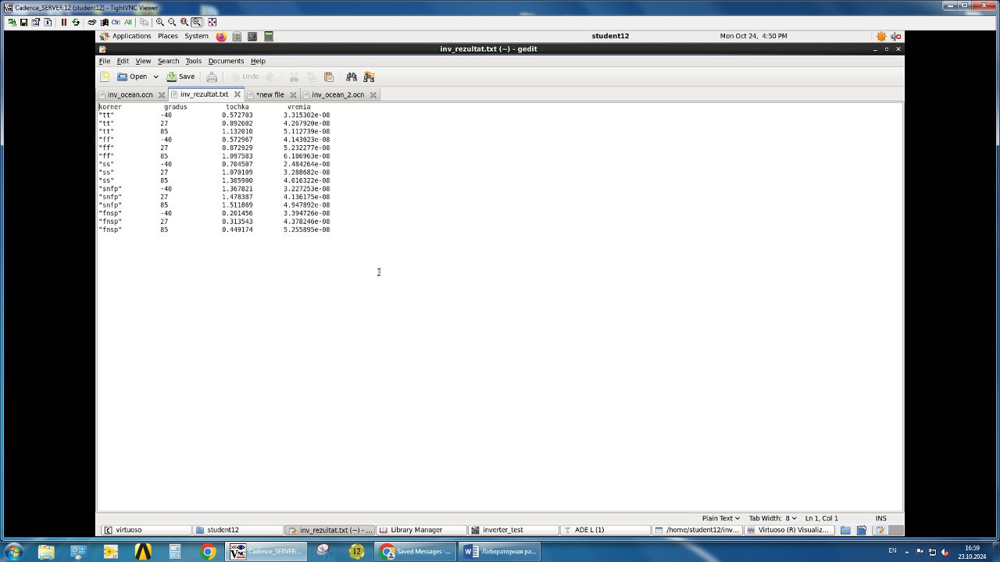
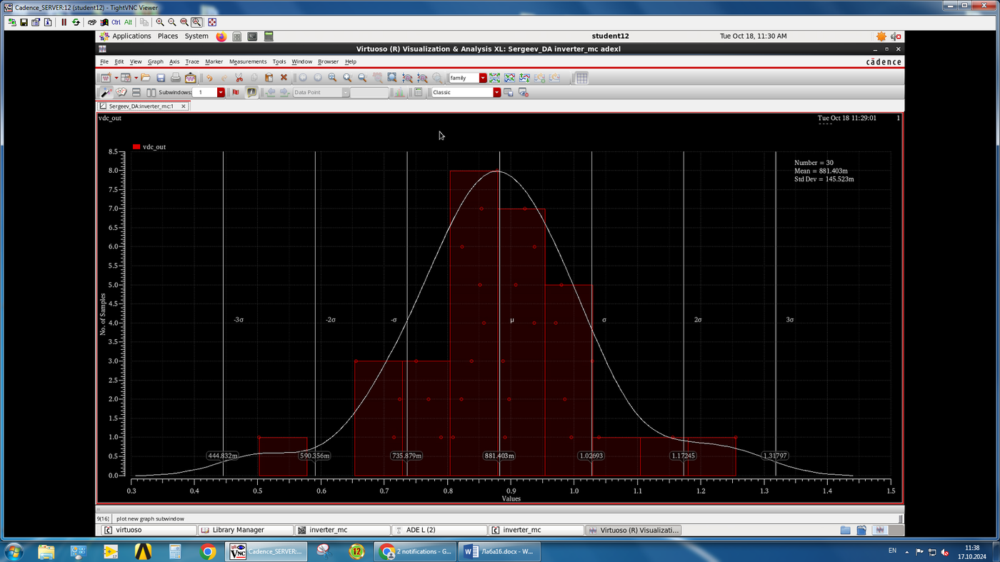
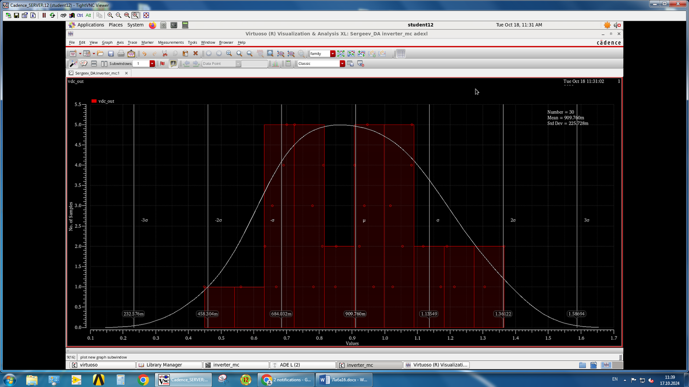
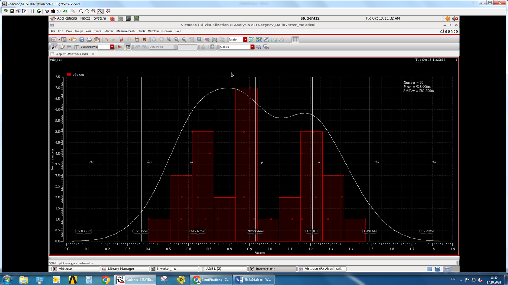

# Simulation Automation and Statistical Analysis in Cadence

Laboratory works "Introduction to Integrated Circuit Modeling" (SPbPU, 2024). A CMOS inverter and a differential amplifier were characterized across temperature, supply voltage and process variation, the runs were automated with OCEAN scripts, and statistical spread was analyzed with Monte Carlo.

**Tools:** Cadence Virtuoso ADE L / ADE XL, Spectre, OCEAN. **Technology:** 0.18 um CMOS, 1.8 V standard transistors.

## Inverter characterization

- DC transfer curve, transient response, supply current and eye diagram for several load capacitances.
- Parametric sweep of the p-transistor width to symmetrize the transfer curve (p-width 1.13 um).
- Temperature sweep (-40, 27 and 85 C): the transfer curve shifts by about +-20 mV.
- Supply voltage sweep: the transfer curve shifts by about +-50 mV.
- Process corners: opposite skew of n and p devices ("fnsp", "snfp") is the most critical and moves the switching threshold by about +-50 mV.

## Differential amplifier

Schematic-level AC analysis, low-frequency gain about 23 dB; operating point checked through transistor currents and node voltages.

## OCEAN automation

The ADE setup was exported to an OCEAN script (`inv_ocean.ocn`), edited by hand, run from the console, and extended to a loop over process corners and temperatures. Results (DC output value and rise time for each corner and temperature) were written to a text file.

- Corners: tt, ff, ss, snfp, fnsp
- Temperatures: -40, 27 and 85 C

## Monte Carlo analysis (ADE XL)

Monte Carlo runs of the inverter with the statistical transistor model, 30 samples, for three variation modes: Mismatch, Process and All. The histograms of the DC output voltage `vdc_out` show how much of the spread comes from local mismatch and how much from global process variation.

| Mode | Samples | Mean of vdc_out | Standard deviation |
|------|---------|-----------------|--------------------|
| Mismatch | 30 | 881.4 mV | 145.5 mV |
| All | 30 | 929.0 mV | 281.3 mV |

